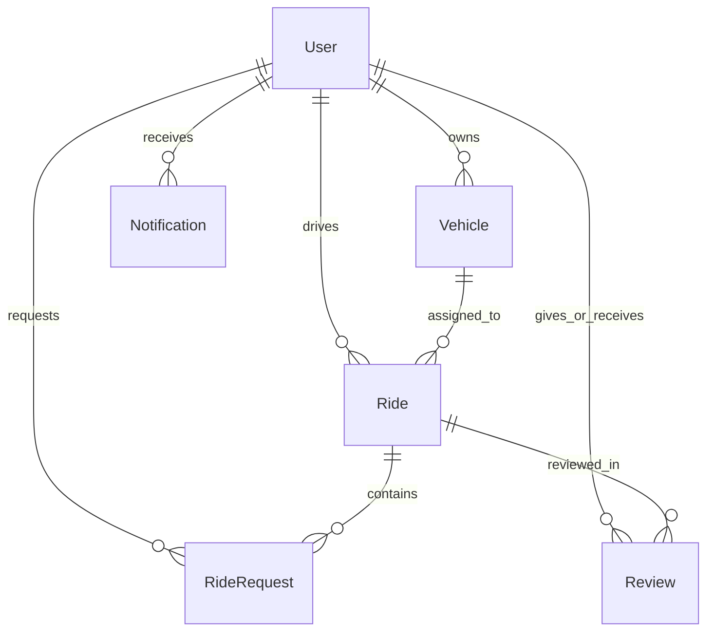
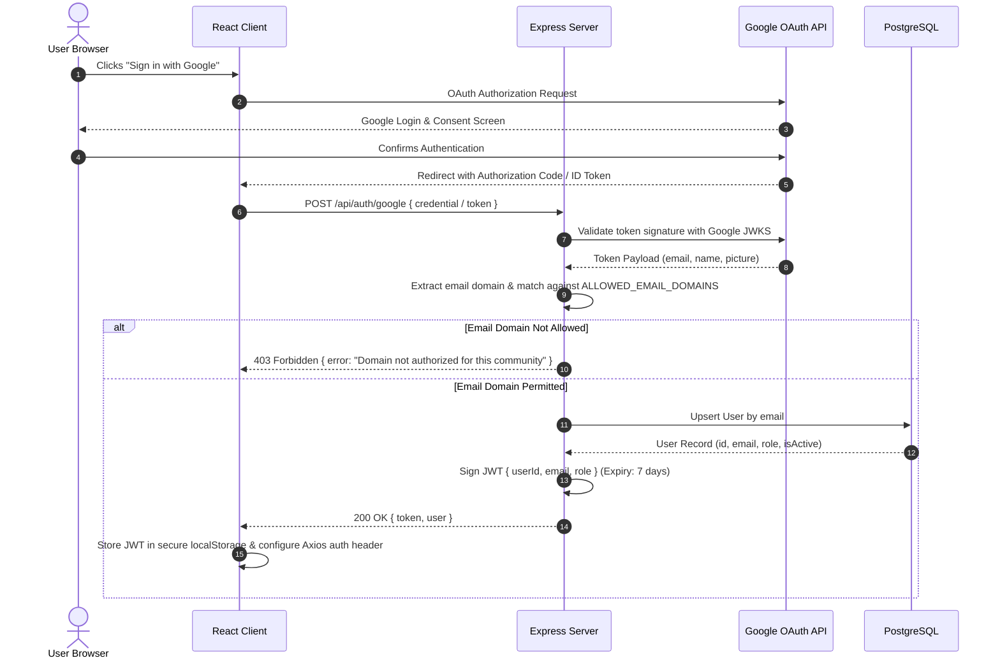
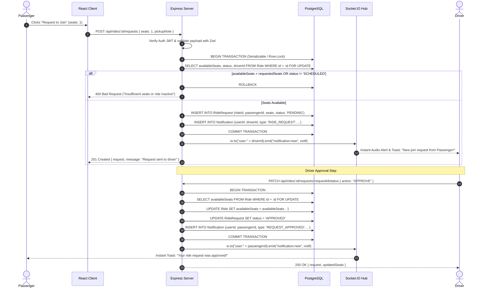

# System Architecture & Technical Specifications
## Project: CommuteCircle - Campus & Community Ride-Sharing Web Platform

---

### 1. High-Level Architecture Overview

CommuteCircle is designed as a decoupled, layered client-server web architecture optimized for high transactional integrity, real-time event dissemination, and strict domain-based zero-trust authentication.

```
+-----------------------------------------------------------------------------------+
|                                  Client Tier                                      |
|                                                                                   |
|   +---------------------------------------------------------------------------+   |
|   |         React 18 Single Page Application (SPA) + Vite + Tailwind CSS       |   |
|   |   - Auth Context / Route Guards                                           |   |
|   |   - Real-time Socket.IO Client Listener                                   |   |
|   |   - State Management (TanStack Query / Zustand / Context)                  |   |
|   +---------------------------------------------------------------------------+   |
+-------------------------|------------------------------------▲--------------------+
                          | HTTPS REST API                     | WSS WebSocket
                          ▼                                    |
+-----------------------------------------------------------------------------------+
|                               Application Tier                                    |
|                                                                                   |
|   +---------------------------------------------------------------------------+   |
|   |                  Node.js / Express Server (TypeScript)                    |   |
|   |   - Security Middleware: Helmet, CORS, Rate-Limiting                     |   |
|   |   - Domain Allowlist & Google OAuth 2.0 / JWT Verification Guard          |   |
|   |   - API Routers: Auth, Users, Vehicles, Rides, Requests, Reviews, Admin   |   |
|   |   - Socket.IO Server: Room-based notification pub/sub                    |   |
|   |   - Service Layer: Business rules, atomic concurrency seat reservation   |   |
|   |   - Data Access Layer: Prisma ORM Client                                 |   |
|   +---------------------------------------------------------------------------+   |
+-------------------------|---------------------------------------------------------+
                          | Prisma Engine / Connection Pool
                          ▼
+-----------------------------------------------------------------------------------+
|                               Persistence Tier                                    |
|                                                                                   |
|   +---------------------------------------------------------------------------+   |
|   |                         PostgreSQL 15+ Relational DB                     |   |
|   |   - Tables: Users, Vehicles, Rides, RideRequests, Reviews, Notifications  |   |
|   |   - Foreign Keys, Cascade constraints, ACID Transactions                 |   |
|   +---------------------------------------------------------------------------+   |
+-----------------------------------------------------------------------------------+
```

---

### 2. Tech Stack Rationale

| Layer | Technology | Selection Rationale |
| :--- | :--- | :--- |
| **Frontend UI** | **React 18 + Vite + TypeScript** | Extremely fast HMR development cycles, rich ecosystem for map components, modular component architecture, and type-safety aligned with the backend. |
| **Styling** | **Tailwind CSS** | Atomic utility-first styling with zero CSS file bloat, consistent design tokens (colors, spacing, typography), and instant dark/light contrast support. |
| **Backend Runtime** | **Node.js (LTS) + Express + TypeScript** | Non-blocking asynchronous I/O ideal for high-concurrency WebSocket subscriptions and concurrent HTTP REST transactions with unified TypeScript models. |
| **ORM & Migrations** | **Prisma ORM** | Type-safe query generation eliminating raw SQL runtime errors, deterministic migrations, declarative data modeling, and robust transactional primitives (`$transaction`). |
| **Primary Database** | **PostgreSQL 15+** | Rock-solid ACID guarantees required for seat locking, robust indexing on location and timestamps, JSONB support for extensibility, and industry-standard reliability. |
| **Realtime Engine** | **Socket.IO (Engine.IO v4)** | Automatic fallback from WebSocket to long-polling, room-based multicasting per user ID, and reconnect resiliency across network disruptions. |
| **Auth & Security** | **Google OAuth 2.0 + JWT + Zod** | Eliminates custom password storage security hazards; domain validation enforces institutional access; Zod ensures end-to-end request payload sanitization. |

---

### 3. Repository Structure & Module Breakdown

The project adopts a structured **npm workspaces monorepo** layout (`apps/client`, `apps/server`, `packages/shared`). This guarantees single-command development, strict code reuse of interfaces/DTOs, and clean boundary separation without tooling bloat.

```
ride-share/
├── apps/
│   ├── client/                      # React Frontend Application
│   │   ├── src/
│   │   │   ├── api/                 # Axios / Fetch client wrappers
│   │   │   ├── assets/              # Static media & SVG icons
│   │   │   ├── components/          # Reusable UI widgets (modals, forms, cards)
│   │   │   ├── context/             # AuthContext, SocketContext, NotificationContext
│   │   │   ├── hooks/               # Custom React hooks (useRides, useSocket)
│   │   │   ├── pages/               # Routed views (Dashboard, Search, RideDetail, etc.)
│   │   │   ├── types/               # Client-specific interfaces
│   │   │   ├── utils/               # Date formatters, coordinate calculators
│   │   │   ├── App.tsx
│   │   │   └── main.tsx
│   │   ├── index.html
│   │   ├── package.json
│   │   ├── tsconfig.json
│   │   └── vite.config.ts
│   └── server/                      # Node.js + Express Backend
│       ├── prisma/
│       │   ├── schema.prisma        # Prisma data models & migrations
│       │   └── seed.ts              # Database seeds (mock users, vehicles, rides)
│       ├── src/
│       │   ├── config/              # Environment config, constants
│       │   ├── controllers/         # HTTP Route handlers
│       │   ├── middleware/          # AuthGuard, domainValidator, errorHandler, rateLimiter
│       │   ├── routes/              # Express Router definitions
│       │   ├── services/            # Core business logic & DB transactions
│       │   ├── sockets/             # Socket.IO connection handling & events
│       │   ├── utils/               # JWT helper, logger, validation schemas
│       │   └── app.ts               # Express app initialization
│       ├── tests/                   # Integration and unit tests
│       ├── package.json
│       └── tsconfig.json
├── packages/
│   └── shared/                      # Shared types, constants, Zod schemas
│       ├── src/
│       │   ├── index.ts
│       │   ├── types.ts             # User, Ride, Request, Notification interfaces
│       │   └── schemas.ts           # Zod validation schemas
│       ├── package.json
│       └── tsconfig.json
├── docker-compose.yml               # Local PostgreSQL container definition
├── .env.example                     # Unified environment template
├── package.json                     # Monorepo root workspace configuration
├── tsconfig.base.json               # Monorepo root TypeScript config
├── PRD.md
├── architecture.md
├── rules.md
├── design.md
├── task.md
└── memory.md
```

---

### 4. Data Model Overview (Prisma Schema Summary)

#### 4.1 Entities & Relational Mapping



#### 4.2 Entity Attributes Summary

| Table | Column Name | Type | Constraints / Attributes | Description |
| :--- | :--- | :--- | :--- | :--- |
| **User** | `id` | `String (UUID)` | PK, default `uuid()` | Unique user identifier |
| | `email` | `String` | Unique, Indexed | Verified institutional email address |
| | `name` | `String` | Not Null | User display name |
| | `avatarUrl` | `String?` | Nullable | Profile photo from OAuth or uploaded |
| | `role` | `Enum (USER, ADMIN)` | Default `USER` | Platform access level |
| | `department` | `String?` | Nullable | Campus major/department or workplace unit |
| | `phoneNumber` | `String?` | Nullable | Contact number for ride coordination |
| | `bio` | `String?` | Nullable | Short user profile bio |
| | `isActive` | `Boolean` | Default `true` | Account active / suspended status |
| | `createdAt` | `DateTime` | Default `now()` | Timestamp created |
| | `updatedAt` | `DateTime` | Auto-update | Timestamp updated |
| **Vehicle** | `id` | `String (UUID)` | PK, default `uuid()` | Unique vehicle identifier |
| | `userId` | `String (UUID)` | FK -> `User.id`, Cascade | Vehicle owner |
| | `make` | `String` | Not Null | Manufacturer (e.g. Honda, Toyota) |
| | `model` | `String` | Not Null | Model (e.g. Civic, Prius) |
| | `year` | `Int` | Not Null | Manufacture year |
| | `color` | `String` | Not Null | Vehicle exterior color |
| | `licensePlate` | `String` | Unique per region | Official license plate string |
| | `capacity` | `Int` | Check `(capacity > 0)` | Maximum passenger seat capacity |
| | `createdAt` | `DateTime` | Default `now()` | Creation date |
| **Ride** | `id` | `String (UUID)` | PK, default `uuid()` | Unique ride identifier |
| | `driverId` | `String (UUID)` | FK -> `User.id`, Cascade | Driver user ID |
| | `vehicleId` | `String (UUID)` | FK -> `Vehicle.id` | Vehicle used for this trip |
| | `origin` | `String` | Not Null | Origin human-readable address |
| | `originLat` | `Float?` | Nullable | Departure latitude |
| | `originLng` | `Float?` | Nullable | Departure longitude |
| | `destination` | `String` | Not Null | Destination human-readable address |
| | `destLat` | `Float?` | Nullable | Arrival latitude |
| | `destLng` | `Float?` | Nullable | Arrival longitude |
| | `departureTime`| `DateTime` | Indexed | Scheduled departure time |
| | `totalSeats` | `Int` | Not Null | Total passenger seats offered |
| | `availableSeats`| `Int` | Check `(availableSeats >= 0)` | Unclaimed available seats |
| | `pricePerSeat` | `Decimal` | Default `0.00` | Voluntary fuel/parking contribution |
| | `status` | `Enum` | `SCHEDULED, IN_PROGRESS, COMPLETED, CANCELLED` | Lifecycle state |
| | `notes` | `String?` | Nullable | Additional notes (luggage, music, pickup point) |
| | `createdAt` | `DateTime` | Default `now()` | Record creation timestamp |
| **RideRequest**| `id` | `String (UUID)` | PK, default `uuid()` | Unique join request identifier |
| | `rideId` | `String (UUID)` | FK -> `Ride.id`, Cascade | Target ride |
| | `passengerId` | `String (UUID)` | FK -> `User.id`, Cascade | Requesting passenger |
| | `seats` | `Int` | Default `1` | Number of seats requested |
| | `status` | `Enum` | `PENDING, APPROVED, REJECTED, CANCELLED` | Request state |
| | `pickupNote` | `String?` | Nullable | Specific pickup intersection or note |
| | `createdAt` | `DateTime` | Default `now()` | Request submission time |
| | `updatedAt` | `DateTime` | Auto-update | Last status change timestamp |
| **Review** | `id` | `String (UUID)` | PK, default `uuid()` | Unique review identifier |
| | `rideId` | `String (UUID)` | FK -> `Ride.id` | Target ride reference |
| | `reviewerId` | `String (UUID)` | FK -> `User.id` | Author of review |
| | `revieweeId` | `String (UUID)` | FK -> `User.id` | Target driver or passenger |
| | `rating` | `Int` | Check `(rating BETWEEN 1 AND 5)` | Rating out of 5 stars |
| | `comment` | `String?` | Nullable | Feedback commentary |
| | `createdAt` | `DateTime` | Default `now()` | Review timestamp |
| **Notification**| `id` | `String (UUID)` | PK, default `uuid()` | Unique notification ID |
| | `userId` | `String (UUID)` | FK -> `User.id`, Cascade | Recipient user |
| | `title` | `String` | Not Null | Alert headline |
| | `message` | `String` | Not Null | Human-readable content |
| | `type` | `Enum` | `RIDE_REQUEST, REQUEST_APPROVED, REQUEST_DECLINED, RIDE_CANCELLED, SYSTEM` | Category tag |
| | `metadata` | `Json?` | Nullable | Context payload (e.g., `{ rideId, requestId }`) |
| | `isRead` | `Boolean` | Default `false` | Read tracking indicator |
| | `createdAt` | `DateTime` | Default `now()`, Indexed | Timestamp generated |

---

### 5. Authentication Architecture & Domain Allowlist



#### Development & Testing Authentication Bypass
For automated tests and local development where Google OAuth credentials might not be configured, the backend provides a conditional development auth route: `POST /api/auth/dev-login` (active only when `NODE_ENV !== 'production'`). This allows instant token generation for predefined test profiles (`alice@campus.edu`, `bob@campus.edu`), strictly preserving the domain allowlist check.

---

### 6. Real-Time Notification Architecture (Socket.IO)

1. **Authentication Handshake:**
   - On WebSocket connection, the client passes the JWT in `socket.handshake.auth.token`.
   - The server middleware verifies the token, resolves `userId`, and joins a private room: `socket.join("user:" + userId)`.
2. **Notification Dispatch Flow:**
   - Any domain action triggering a notification (e.g., `createRideRequest`, `approveRequest`, `cancelRide`) executes within a service layer function.
   - The service writes the notification record to the database via Prisma (`Notification.create`).
   - The service then emits the persisted notification directly to the target room:
     ```ts
     io.to(`user:${targetUserId}`).emit("notification:new", notificationPayload);
     ```
3. **Resiliency:**
   - If a user is offline, the notification remains stored in PostgreSQL.
   - When the client connects/reconnects, the client requests `GET /api/notifications` to fetch unread notifications, ensuring zero dropped messages.

---

### 7. Core Sequence: "Request to Join Ride" Flow



---

### 8. Security Considerations

- **Input Validation:** Every HTTP endpoint runs Zod schema validators before controller execution. Invalid inputs fail immediately with standardized 422/400 JSON errors.
- **SQL Injection Prevention:** 100% of database queries leverage Prisma ORM's parameterized query engine. Raw queries are disallowed.
- **Rate Limiting:** `express-rate-limit` guards public endpoints (Auth: 15 req/15min; Ride Search: 60 req/min) to thwart denial-of-service and brute force attempts.
- **CORS Protection:** Configured strictly to the React client origin (`http://localhost:5173` in development; explicit production domain in deployment).
- **Security Headers:** `helmet` middleware enforced for content security policies, HSTS, and X-Content-Type-Options.
- **Secret Isolation:** Environment variables (`JWT_SECRET`, `DATABASE_URL`, `GOOGLE_CLIENT_ID`) are strictly loaded via `.env` and never checked into source control.

---

### 9. Deployment Strategy for College Projects

#### 9.1 Local Development (Windows 10/11 Target)
- **Database:** PostgreSQL containerized via `docker-compose up -d` running on port 5432.
- **Backend:** Node.js Express server running on `http://localhost:5000` via `npm run dev:server`.
- **Frontend:** Vite React development server running on `http://localhost:5173` via `npm run dev:client`.

#### 9.2 Simple Cloud Deployment (Free/Student Tier)
- **Database:** Managed PostgreSQL on Supabase, Neon.tech, or Render (free tier).
- **Backend API:** Container or Web Service hosted on Render / Railway with environment variables populated via dashboard.
- **Frontend SPA:** Static hosting on Vercel or Netlify with rewrite rules for client-side routing (`/* -> index.html`).
